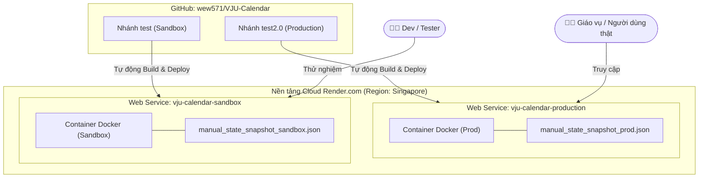

# 🚀 Hướng Dẫn Deploy VJU-Calendar Lên Render.com (Production & Sandbox)

Tài liệu này hướng dẫn chi tiết cách triển khai hệ thống **VJU-Calendar** thành 2 môi trường độc lập:
- **Production (Môi trường thật):** Chạy từ nhánh `test2.0` (dành cho giáo vụ và người dùng chính thức).
- **Sandbox (Môi trường thử nghiệm):** Chạy từ nhánh `test` (dành cho dev/tester thử nghiệm thuật toán xếp lịch và chức năng mới mà không lo làm hỏng dữ liệu thật).

---

## 🏗️ 1. Kiến Trúc Triển Khai



### Các tối ưu đã được thiết lập sẵn trong mã nguồn:
1. **Dockerfile đa tầng (Multi-stage build):**
   - Tự động cài đặt Node.js, copy cấu hình mẫu `config/frontend-example.json` và build React Vite ra thư mục `frontend/dist`.
   - Đóng gói môi trường Python 3.11, cài đặt `ortools`, `flask`, `openpyxl` và `gunicorn`.
2. **Web Server Gunicorn chuẩn Production:**
   - Chạy với `--workers 1 --threads 4` để đảm bảo tính nhất quán của `STATE` trong bộ nhớ RAM (do hệ thống sử dụng state bộ nhớ để lưu trữ dữ liệu phiên làm việc).
3. **Phân tách dữ liệu qua biến môi trường `SNAPSHOT_PATH`:**
   - Production lưu snapshot tại `manual_state_snapshot_prod.json`.
   - Sandbox lưu snapshot tại `manual_state_snapshot_sandbox.json`.
   - Giúp 2 môi trường hoàn toàn không bao giờ bị ghi đè chéo dữ liệu.

---

## 🛠️ 2. Các Bước Đưa File Lên 2 Nhánh Trên GitHub

Trước khi thiết lập trên Render, bạn cần commit các file cấu hình mới (`Dockerfile`, `render.yaml`, `docker-compose.yml`,...) vào cả 2 nhánh.

Mở Terminal tại thư mục dự án và chạy các lệnh sau:

### Bước 2.1: Đưa cấu hình vào nhánh `test` (Sandbox)
```bash
# 1. Chuyển sang nhánh test
git checkout test

# 2. Thêm các file cấu hình deploy
git add Dockerfile render.yaml docker-compose.yml webapp/app.py webapp/requirements.txt webapp/snapshot.py doc/HUONG_DAN_DEPLOY_RENDER.md

# 3. Commit
git commit -m "Add Dockerfile, Render Blueprint and multi-environment deployment config"

# 4. Push lên GitHub
git push origin test
```

### Bước 2.2: Đưa cấu hình vào nhánh `test2.0` (Production)
```bash
# 1. Chuyển sang nhánh test2.0
git checkout test2.0

# 2. Hợp nhất cấu hình từ nhánh test (hoặc cherry-pick / merge)
git merge test -m "Merge deployment config from test"

# 3. Push lên GitHub
git push origin test2.0
```

---

## 🌐 3. Thiết Lập Triển Khai Trên Render.com

Có 2 cách để thiết lập trên Render:

### Cách 1: Sử dụng Render Blueprint (Nhanh nhất - 1 cú click)
File `render.yaml` đã được tạo sẵn ở thư mục gốc của repo:
1. Đăng nhập vào [Render.com](https://render.com) (nên đăng nhập bằng tài khoản GitHub).
2. Tại trang Dashboard, nhấn nút **New +** ở góc phải trên -> chọn **Blueprint**.
3. Chọn repository **`wew571/VJU-Calendar`**.
4. Nhập tên Blueprint Instance (ví dụ: `vju-calendar-system`).
5. Render sẽ tự động đọc file `render.yaml` và phát hiện 2 dịch vụ:
   - `vju-calendar-production` (từ nhánh `test2.0`)
   - `vju-calendar-sandbox` (từ nhánh `test`)
6. Nhấn **Apply**. Render sẽ tự động kéo code, build Docker image và cấp cho bạn 2 đường link URL riêng biệt!

---

### Cách 2: Thiết lập thủ công 2 Web Services trên Dashboard

Nếu bạn muốn tạo từng dịch vụ thủ công:

#### A. Tạo Môi Trường Production:
1. Nhấn **New +** -> **Web Service**.
2. Chọn repo `wew571/VJU-Calendar`.
3. Điền thông tin:
   - **Name:** `vju-calendar-production`
   - **Region:** `Singapore` (để tốc độ tải trang nhanh nhất tại Việt Nam)
   - **Branch:** `test2.0`
   - **Runtime:** `Docker`
   - **Instance Type:** `Free`
4. Mở mục **Advanced** -> thêm Environment Variable:
   - `ENVIRONMENT`: `production`
   - `SNAPSHOT_PATH`: `/app/webapp/data/manual_state_snapshot_prod.json`
5. Nhấn **Create Web Service**.

#### B. Tạo Môi Trường Sandbox:
1. Nhấn **New +** -> **Web Service**.
2. Chọn repo `wew571/VJU-Calendar`.
3. Điền thông tin:
   - **Name:** `vju-calendar-sandbox`
   - **Region:** `Singapore`
   - **Branch:** `test`
   - **Runtime:** `Docker`
   - **Instance Type:** `Free`
4. Mở mục **Advanced** -> thêm Environment Variable:
   - `ENVIRONMENT`: `sandbox`
   - `SNAPSHOT_PATH`: `/app/webapp/data/manual_state_snapshot_sandbox.json`
5. Nhấn **Create Web Service**.

---

## 🔄 4. Quy Trình Vận Hành & CI/CD Sau Khi Deploy

Sau khi hoàn tất, cơ chế tự động hóa hoạt động như sau:

| Thao tác | Hành vi hệ thống | Môi trường áp dụng |
|---|---|---|
| Khi push code sửa đổi lên nhánh **`test`** | Render tự động kích hoạt webhook, rebuild Docker container | **Sandbox** cập nhật sau ~2-3 phút |
| Khi kiểm thử thành công trên Sandbox và merge vào **`test2.0`** | Render tự động kích hoạt webhook, rebuild bản chính thức | **Production** cập nhật cho người dùng |

---

## 💡 Lưu Ý Quan Trọng Về Gói Miễn Phí (Free Tier) Của Render
- Khi không có lượt truy cập trong 15 phút, dịch vụ trên gói Free sẽ tạm thời "ngủ" (Spin down).
- Khi có người truy cập trở lại, container sẽ mất khoảng 30 - 50 giây để khởi động lại (Cold Start). Sau khi đã bật lên, các thao tác kéo thả và xếp lịch CP-SAT sẽ diễn ra bình thường và mượt mà.
- Nếu muốn chạy 24/7 không bao giờ ngủ, bạn có thể nâng cấp dịch vụ Production lên gói **Starter (\$7/tháng)** và giữ Sandbox ở gói **Free**.
